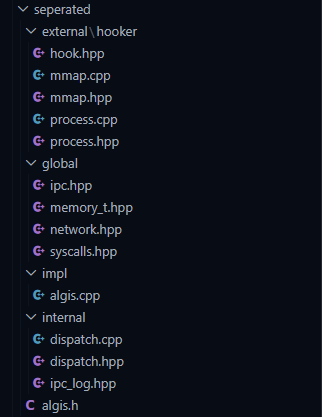

## ALGIS 
*a cheat library, filled with a collection of tools i made over the years. the dream of a skid*
**CREATED BY FREASKTER, AKA \<algis.h> on TikTok and Instagram.** 
**Discord is `ownerofsomethingbruh`**
*check [LICESNSE](https://github.com/bob-ham/algis/blob/master/LICENSE) for license details*

**STRUCTURE**
- since this is no longer algis v1.0 where it was a single header file (now deprecated, i made it as a challenge and i maded making it myself)
- everything is split in this file structure
- 

**MACROS**
- define these <i>BEFORE<i> including `algis.h`
- `ALGIS_EXTERNAL` : you are external (default if neither is defined)
- `ALGIS_INTERNAL` : you are internal (DLL)
- `ALGIS_LEAN`     : cuts out networking `network.hpp`
- `ALGIS_FULL`     : pulls in `memory_t.hpp`, `dispatch.hpp`, `ipc_log.hpp`
- `ALGIS_LUA`      : lua support *(WIP)*
- *NOTE:* `ALGIS_INTERNAL` and `ALGIS_EXTERNAL` cannot be defined at once
- helper macros:
- `__attr_pack__`     -> `_Pragma("pack(push, 1)")`
- `__attr_pop__`      -> `_Pragma("pack(pop)")`
- `ALGIS_API`         -> `ALGIS_STATUS __stdcall`
- `DESTROY_HOOK_ALL`  -> `nullptr`
- `IPC_THREAD_CREATE` -> `true`
- `IPC_MAGIC`         -> `"algis_ipc"`
- `XPIPE`             -> `1`
- `XSMEM`             -> `2`

**DLL INJECTION**
- the skids love this one
- manual mapper + IAT hooker + syscall resolver. im not 100% if this is detected or not but it works
- there are drawbacks, there is *!!NO!!* CRT (C Runtime Library)
- `Process` class; opens handle to target process, falls back to handle hijacking if `OpenProcess` fails (located in `process.hpp/cpp`)
- `mapper` class; manually maps a DLL into target process (located in `mmap.hpp/cpp`)
- `Hook` struct; IAT hooker struct (located in `hook.hpp`)

**SYSCALLS**
- self explantory, resolves syscalls via halo gates

**MEMORY**
- `memory_t`; external memory class, inherits `Process`
- `internal_memory_t`; internal memory class

**IPC**
- this is one of the more complex stuff, so ill keep it simple
- transport type: `XPIPE` (1); named pipes (i focused on this more), second is `XSMEM` (2)
- every packet starts with `IpcHeader` (`IPC_MAGIC`)
- there is commands, via `AlgisCmd`
- `0x01` `AL_PING`    : direction is external->internal; alive check
- `0x02` `AL_DATA`    : direction is external->internal; sends data
- `0x03` `AL_EXECUTE` : direction is external->internal; is a stub, user defined
- `0x04` `AL_LOG`     : direction is internal->external; log entry from DLL
- basic implentation would be this
```
// send
algis::xsend(XPIPE, L"\\\\.\\pipe\\mypipe", &data, sizeof(data));

// recieve
BYTE buf[512];
DWORD read = 0;
algis::xrecieve(XPIPE, L"\\\\.\\pipe\\mypipe", buf, sizeof(buf), &read, 5000);
```
- dispatcher (internal)
```
dispatcher d(L"\\\\.\\pipe\\mypipe");
d.on_data([](const BYTE* buf, DWORD size) {
  // handle AL_DATA
});
d.start();
// d.stop() to shutdown
```
- ipc logging
```
// internal side, to be sent out
algis::ipc_log(L"\\\\.\\pipe\\mypipe", 0 "hook installed");

// external side
BYTE buf[sizeof(IpcCmd) + sizeof(IpcLog)];
DWORD read = 0;
algis::xrecieve(XPIPE, L"\\\\.\\pipe\\mypipe", buf, sizeof(buf), &read, INFINITE);
IpcCmd* cmd = reinterpret_cast<IpcCmd*>(buf);
if (cmd->cmd_id == AL_LOG) {
    IpcLog* log = reinterpret_cast<IpcLog*>(buf + sizeof(IpcCmd));
    // log->level, log->msg
}
```

**OFFSET FETCHING (requires !ALGIS_LEAN)**
- fetches a .hpp file (JSON parser is complex and i dont feel like including nlohmans or whatever its called)
- example
```
algis::fetch("https://my.mycooloffsets.com/superoffsets.hpp", "C:\\myproject\\myoffsets.hpp");
std::uintptr_t offset = algis::get("offset");
```

**FLogger**
- simple logger, uses raw win32
- `LOG_INIT(filename)`; set your log file path
- `ILOG(fmt, ...)`; INFO tag + timestamp
- `WLOG(fmt, ...)`; WARN tag + timestamp
- `ELOG(fmt, ...)`; ERROR tag + timestamp

**WHAT MIGHT COME NEXT**
- lua embedding `ALGIS_LUA`
- more internal helpers
